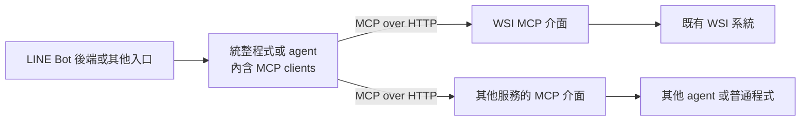

# WSI agent 的服務整合方向

這份是根據使用者描述整理的學習與架構構想，不是已部署系統的說明。尚未讀取 WSI 專案、合作團隊服務介面或醫院網路設定。

## 兩個目標

1. 將既有 WSI agent 放到合作團隊管理的伺服器，提供可被別人呼叫的功能。
2. 未來由統整程式／agent 組合 WSI 與其他服務，必要時在流程中取得彼此的結果。

LINE Bot 是可能入口之一；其他 agent 的種類與實際串接流程尚未確定。

## 本機程序與遠端服務

目前 `client.py` 的 `StdioServerParameters` 保存啟動設定；進入 `async with Client(SERVER, ...)` 時，SDK 才依設定啟動 server 子程序。兩個程序透過 stdin/stdout 溝通，client 結束時清理子程序。

HTTP 模式下，server 由部署方獨立啟動、常駐。Client 只連到 MCP endpoint，例如 `http://127.0.0.1:8000/mcp`（示意網址，尚未建立）。Client 結束通常不會讓服務停止。服務可以處理多個 client 的請求，但真實分析的併發量仍由實作與資源決定。

服務可先只開在本機，之後放到受控內網或 VPN，不必直接公開到網際網路。公網部署還需處理網路路由、TLS、存取驗證與服務維運；MCP 不代替這些工作。

## 一個可行的整合形狀

這是可採用的架構，不要求所有服務全面改成 MCP。入口與統整程式可使用一般 HTTP API；服務沒有 MCP 時，統整程式也可以直接呼叫原 API。

## MCP 和既有 API 的關係

- 固定流程且呼叫雙方由你們控制時，直接約定 API 路徑、輸入、輸出，就能完成整合。
- 同一組功能希望被不同 MCP host/client 重用，或需要統一列工具、參數描述、呼叫與結果格式時，可提供 MCP 介面。
- MCP 介面後面可呼叫既有 HTTP API、Python 函式、命令列工具，不強制再經過一層 API。
- 一個 MCP server 可提供多個工具、整合多項服務；如何拆分依維護邊界、權限與部署需求決定，不必一個 agent 配一個 server。
- 腳本可直接充當 MCP client，完全不需要 LLM；目前的 `client.py` 就是例子。MCP 標準化通訊與功能描述，不自動決定分析流程或跨 agent 合作策略。
- 同一個系統可對外提供 MCP server 介面，也內含 MCP client 去呼叫其他服務。這是兩種職責，不等於在同一條連線讓對方任意回呼，也不代表應無限制互叫。

## 第一個 WSI 練習

先做假資料工具 `get_slide_info(slide_id)`，不要求真實模型或影像。輸出明確標記 demo，先驗證服務接線與輸入／輸出，再接真實入口。

取得現有程式後，再討論：

- WSI agent 的啟動入口、必要參數、輸出格式與實際耗時。
- 影像由誰保存、如何以有權限的 ID 找到影像；初期不將整張大型 WSI 塞進工具參數或模型上下文。
- 需要立即回結果，還是提交後回覆 job ID；如何處理排隊、逾時、重試與資源限制。
- 哪些呼叫由固定程式決定、哪些需模型選擇；交換的是資料、工作狀態還是對話內容。
- 真正部署時，對不同使用者／病例資料的存取權限如何檢查，結果如何儲存與追蹤。

## 查核來源

- [官方 stdio 規範](https://modelcontextprotocol.io/specification/2026-07-28/basic/transports/stdio)
- [官方 Streamable HTTP 規範](https://modelcontextprotocol.io/specification/2026-07-28/basic/transports/streamable-http)
- [官方架構說明](https://modelcontextprotocol.io/docs/2026-07-28/learn/architecture)
- 本機鎖定的官方 Python SDK 2.3.0：`Client.__aenter__` 與 stdio transport。
